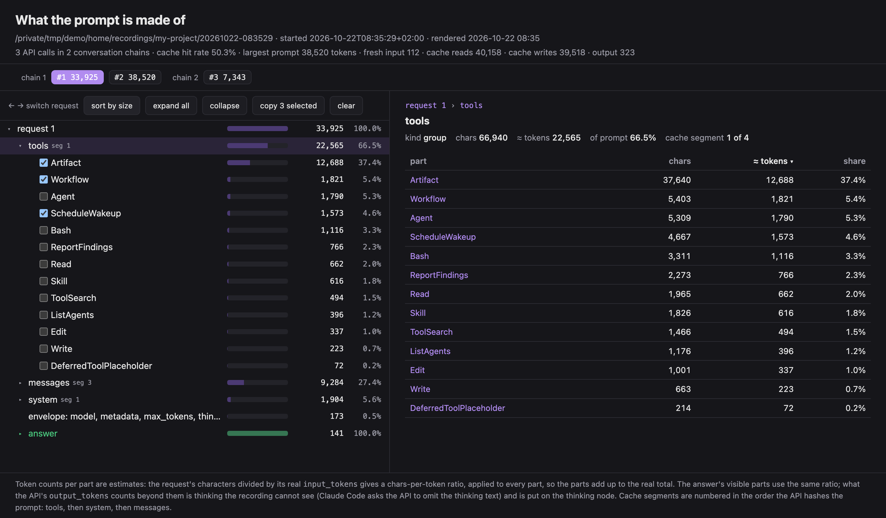

# claude-context-profiler

See exactly what Claude Code sends to the model. It helps you:

- cut your token spend
- understand Claude Code one level deeper

## Quick start

You need [uv](https://docs.astral.sh/uv/) and Claude Code on your PATH.

1. Install it:

   ```bash
   uv tool install git+https://github.com/MindWrapper/claude-context-profiler
   ```

2. In your project folder, start Claude Code with `ccprof` instead of `claude`:

   ```bash
   ccprof
   ```

3. Claude's start screen shows the address of your live page. Click it:

   ```
   ╭────────────────────────────────────────────────╮
   │  Context profiler  →  http://127.0.0.1:54972/  │
   ╰────────────────────────────────────────────────╯
   ```

4. Work with Claude as usual, and watch your context build up, request by request:

   

   - **What happened, step by step:** the **Session** tab shows the session as Claude Code does:
     your prompts, Claude's replies and tool calls, and each subagent's steps under the call that
     started it. Click a step to see the request it came from.
   - **What a request is made of:** tools, system prompt, skills, MCP servers and messages, biggest
     first. Click any part to read it, or search for a word.
   - **What each request adds:** new parts have a blue dot, and **Only new** hides the rest.
   - **What the cache did:** open the **timeline** at the top: each bar shows what was read from the
     cache, written to it, or sent fresh.
   - **Where the subagents ran:** each subagent gets its own row in the timeline, under the
     conversation that started it.
   - **What the session used:** "used 3×" next to the tools, skills and servers Claude called.

When you quit Claude, the recording stops and the page is saved; `ccprof` prints its path as it
exits.

## Your data stays local

- The profiler adds no remote server, account or telemetry. Claude's requests go to the same API
  as always.
- The recorder and the page listen on `127.0.0.1` only. The page loads nothing from the internet.
- Your API key and sign-in token are never saved; the recording blanks them out. Extra headers you
  add with `ANTHROPIC_CUSTOM_HEADERS` are saved as they are.
- Recordings hold your prompts and the files Claude read. They live in
  `~/.claude-context-profiler/recordings/`; delete them any time.

## Switching things off

Tick what you want off and press **Disable prompt**. It gives you a prompt to paste into Claude,
which shows you the change to `~/.claude/settings.json` and asks before it writes. The profiler
never changes your config itself.

## FAQ

### How do I read the timeline?

Each bar is one request, as tall as its prompt: purple was read from the cache, orange written to
it, blue sent fresh, and red failed. Each conversation has a row, with subagents under the one that
started them and side calls at the bottom.

### How do I find what to cut?

Open a request of your main conversation: the biggest parts come first. A big tool, skill or MCP
server without "used" next to it never ran in this session. Tick it and press **Disable prompt**.

### Why cut it, if it's cached anyway?

The cache makes it cheaper, not free and not smaller:

- **Cost:** every request still reads it, at about a tenth of the price. After a pause the cache
  expires, and the whole prompt is written again at more than full price.
- **Space:** it still fills the context window, so the conversation gets compacted sooner.
- **Context rot:** the more the model has to read past, the less attention it pays to what matters,
  and every unused tool is one more to choose from.

### How do I pass options to Claude?

Put them after `ccprof`; they go to `claude` unchanged. `ccprof --continue` runs
`claude --continue` with recording on.

### How do I update or remove it?

`uv tool upgrade claude-context-profiler` updates it, and
`uv tool uninstall claude-context-profiler` removes it.

### Can the page open by itself?

Yes: with `CLAUDE_CONTEXT_PROFILER_OPEN=1`, your browser opens it at the first API call.

### Can I keep the recordings somewhere else?

Yes: set `CLAUDE_CONTEXT_PROFILER_HOME` to another folder. The default is
`~/.claude-context-profiler`.

### Can I run it without uv?

Yes. Clone the repo and run `PYTHONPATH=CLONE/src python3 -m claude_context_profiler`; it needs
only Python 3.9 or later.

### What happens if I disable a Claude Code tool and later need it?

Claude no longer has the tool, so it works around it, for example with Bash, or tells you it can't
do the task. To bring the tool back, delete its entry from `permissions.deny` in
`~/.claude/settings.json`, or ask Claude to, and start a new Claude Code session. The same goes for
a skill, a subagent type or an MCP server: undo the change the Disable prompt made.

## Limits

- Bedrock, Vertex and Foundry ignore the base URL that recording relies on. The profiler then runs
  Claude Code without recording, as it does whenever the recorder cannot start.
- The recorder connects to the API directly, with Python's own certificates. Behind a corporate
  proxy (`HTTPS_PROXY`) or a network that needs extra certificates (`NODE_EXTRA_CA_CERTS`), Claude
  Code may reach the API while the recorder cannot, and the recorded session's requests fail. Run
  `claude` itself there.
- The Claude desktop app cannot be recorded: it sets `ANTHROPIC_BASE_URL` itself and does not let
  a session override it. Record a terminal session on the same config instead. It comes close: the
  app adds only a few tools of its own.
- The total for each request comes from the API, while the numbers for the parts are the profiler's
  estimates.
