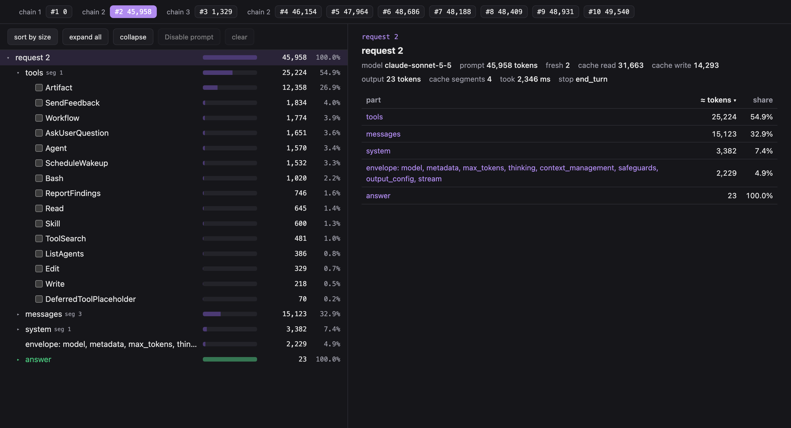
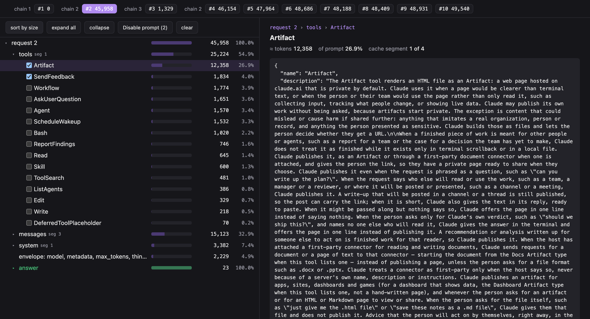
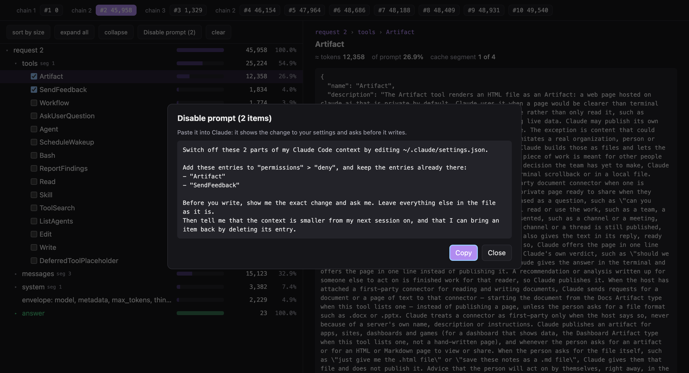
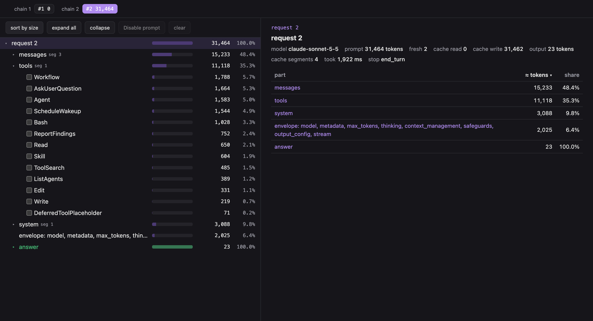

# Two tools, 14,494 tokens: a before and after

This is a real example, recorded with `ccprof` in one project on one afternoon, a few minutes apart.
Every number below comes from the recordings; the totals are the API's own counts.

## Before: a third of every request was two tools

Claude Code sends its tool definitions with **every** request, whether the tools get used or not. The
first request of an ordinary session was 45,958 tokens, and more than half of it was tools:



Sorted by size, two tools stand out at the top, and this work needed neither:

| Tool | Tokens | Share of the request |
|---|---:|---:|
| Artifact | 12,358 | 26.9% |
| SendFeedback | 1,834 | 4.0% |
| **Together** | **14,192** | **30.9%** |

## What those tokens are

Click a tool and the page shows its full definition: the exact text Claude reads on every turn.
Artifact's definition runs to 37,640 characters. Its description opens with *"The Artifact tool
renders an HTML file as an Artifact: a web page hosted on claude.ai…"* and goes on to explain when
to publish, what a published page can do, and which artifact types exist. SendFeedback teaches
Claude to *"draft feedback about Claude Code when you hit a high-signal moment."* Useful for some
people, but pure overhead for anyone who never publishes pages or sends feedback.



## Switching them off

Tick both tools and press **Disable prompt (2)**. The page builds a prompt with the exact setting
for each tool, and shows it before anything is copied:



Paste it into Claude. Claude shows the change and asks before it writes; the whole change to
`~/.claude/settings.json` is:

```json
"permissions": {
  "deny": ["Artifact", "SendFeedback"]
}
```

## After: 31,464 tokens

The next session, same project, same model (Claude Sonnet 5.5):



| | Before | After | Change |
|---|---:|---:|---:|
| Tokens per request | 45,958 | 31,464 | **−14,494 (−31.5%)** |
| Tools | 25,224 (54.9%) | 11,118 (35.3%) | −14,106 |
| Tool definitions sent | 15 | 13 | −2 |

The page's estimate holds up against the API's exact count. It priced the two tools at 14,192
tokens, and the system prompt also lost about 294 tokens that mentioned them: 14,486 estimated
against **14,494 measured**.

## What it adds up to

The before session made 8 main requests, and every one of them carried those 14,494 tokens: about
**116,000 tokens** across one short session. After the first request they are read from the prompt
cache, which is cheaper than fresh input, but they still take up the context window on every turn.
The first session after the change writes a new cache once (31,462 tokens in the after recording);
every session after that starts from the smaller prompt.

## Need one back?

Each tool is one line in `permissions.deny`. Delete `"Artifact"` and it returns on the very next
request, without a restart and without breaking the prompt cache, so "off by default, on when I
need it" costs almost nothing.
